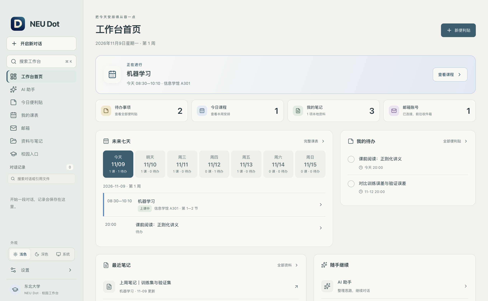
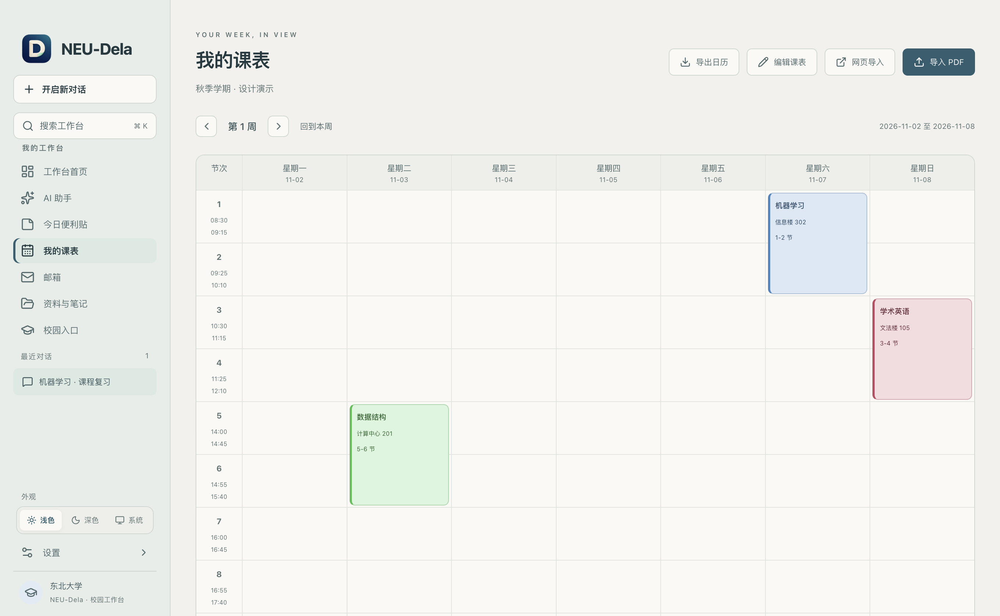
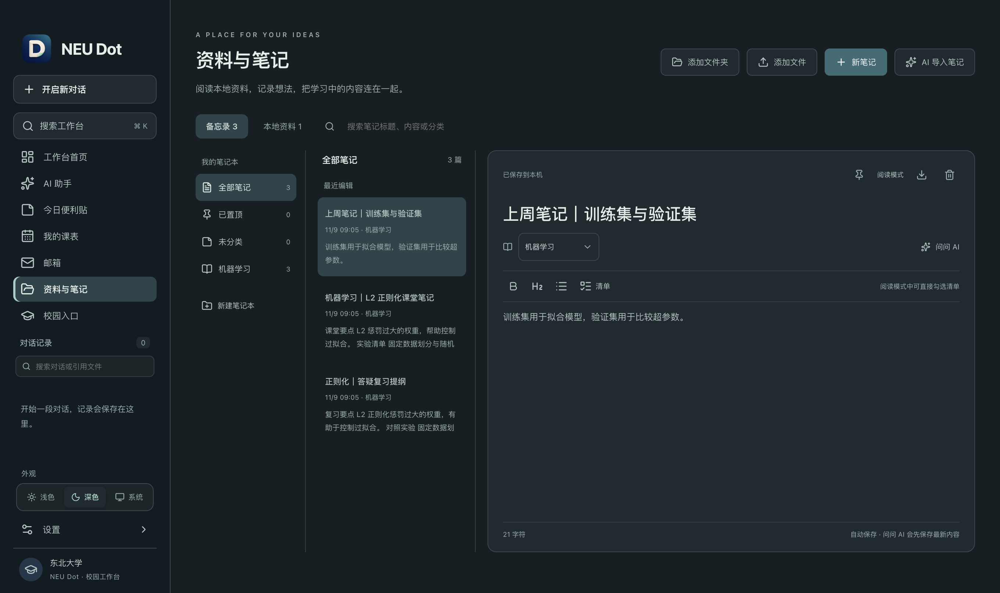
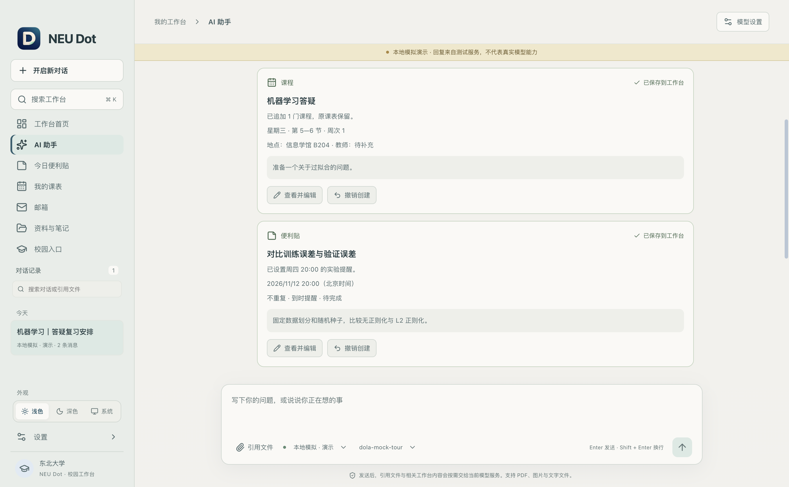
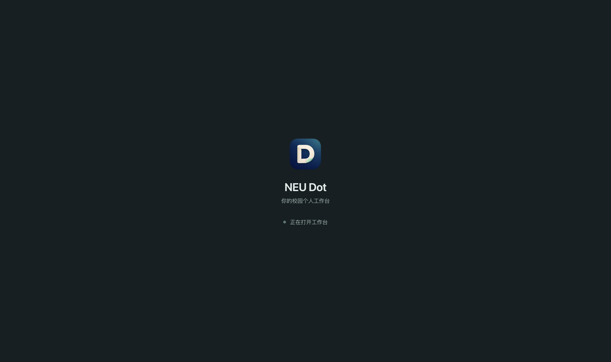

# NEU-Dela

**东北大学（沈阳）学生的本地工作台。** 把课表、待办、笔记、邮件和 AI 放在一起，从今天的安排开始。

面向本科生与研究生，提供 Apple Silicon Mac 与 Windows x64 安装包。当前版本 **0.4.0**。

[下载最新版](https://github.com/yzbcs/NEU-Dela/releases/latest) · [0.4.0 发布说明](https://github.com/yzbcs/NEU-Dela/releases/tag/v0.4.0) · [使用与开发指南](docs/usage.md) · [反馈问题](https://github.com/yzbcs/NEU-Dela/issues)

> 本项目由个人独立开发，非东北大学官方应用。

## 下载

| 平台                  | 安装包                                                                                                          |
| --------------------- | --------------------------------------------------------------------------------------------------------------- |
| macOS · Apple Silicon | [NEU-Dela-0.4.0-arm64.dmg](https://github.com/yzbcs/NEU-Dela/releases/download/v0.4.0/NEU-Dela-0.4.0-arm64.dmg) |
| Windows · x64         | [NEU-Dela.Setup.0.4.0.exe](https://github.com/yzbcs/NEU-Dela/releases/download/v0.4.0/NEU-Dela.Setup.0.4.0.exe) |

安装包暂未签名，系统可能显示发布者提示。Mac 安装包已完成桌面检查；Windows 已打包并检查包内资源，尚未实机运行。

## 从接下来的一件事开始

首页显示当前课程或下一项定时安排，把**未来七天的课程与待办**放在同一条日程中。可以直接完成、恢复待办，打开最近笔记，或进入完整课表。



- **待办与提醒**：四色便利贴、定时与重复提醒、推迟提醒；点击通知定位到对应待办。
- **全局搜索**：按 `⌘/Ctrl + K` 查找笔记、待办、课程、关联资料和聊天，直接打开原记录。
- **外观与启动**：浅色、深色、跟随系统；启动显示加载状态，失败时提供原因与重试入口。

## 把课表带进工作台

支持研究生系统网页读取、PDF 导入和手动录入。保存前预览并修正课程、周次与学期；支持单双周、自定义节次、课程配色、冲突提示和 ICS 导出。点击课程可以新建课堂笔记，或查看同名课程的笔记与资料。



网页导入需要自行登录学校系统并主动读取当前课表。现有导入验证使用研究生样例，本科课表版式仍待补充；扫描 PDF 可手动录入。

## 让笔记和资料留在手边

用笔记本整理课程、阅读记录和随手备忘。支持置顶、正文搜索、模板、自动保存、导出和可勾选清单，也可以关联本机文件、文件夹与链接。



邮箱支持学校云邮箱、QQ、163 和自定义 IMAP/SMTP，可管理多账号、阅读邮件、下载附件、回复和发信。校园入口按本科生、研究生分组，便于打开常用服务。

## AI 读懂工作台，也能按指令保存

连接支持工具调用的模型后，AI 可以查询课表、待办、笔记、已关联资料和已配置邮箱，并附上可点击核对的来源。

明确要求保存时，可以让它**创建待办、追加课程或保存笔记**。完成的操作会留下真实记录的结果卡，支持查看、编辑与撤销。



例如：

- “结合明天的课表和未完成待办，帮我安排学习。”
- “帮我添加明天 20:00 的论文阅读提醒。”
- “把上面的内容保存成笔记。”

模型服务与 API Key 由使用者自行配置，支持 OpenAI Responses、Chat Completions 兼容接口和 Anthropic Messages。开启“工作台已连接”后，相关内容会发送给所选模型服务；关闭后可进行普通聊天。本机文件需先关联，AI 不会发送邮件。

<details>
<summary>查看 0.4.0 启动界面</summary>



数据就绪后进入首页；加载失败时可查看原因并重试。

</details>

以上截图均来自开发验证，使用人工数据。首页、课表与笔记截图来自 0.3.9，其布局在 0.4.0 沿用；AI 操作和启动截图来自 0.4.0。

## 开始使用

1. 安装并打开应用，在“我的课表”导入或手动添加课程。
2. 在首页新建待办，在“资料与笔记”整理笔记与关联文件。
3. 按需在“设置”连接模型服务，在邮箱页配置邮箱账号。

关闭窗口后应用可在托盘继续运行；**退出应用或电脑关机后，提醒不会运行**。AI 并非使用课表、待办和笔记的前提。详细步骤见[使用指南](docs/usage.md)。

## 本地开发

桌面端使用 Electron、React 和 TypeScript。AI 直接对接 OpenAI 与 Anthropic SDK，工具调用循环和工作台操作在项目内实现。

推荐 Node.js **24.22.1**，版本见 [.node-version](.node-version)。

```sh
npm ci
npm run dev
```

使用人工数据和本机模拟模型体验应用：

```sh
npm run demo
```

构建与验证：

```sh
npm run build
npm test
npm run smoke:actions
```

0.4.0 已通过生产构建、123 项单元与本地 HTTP 测试；开发版和最终 Mac 包各通过 11 项桌面检查及重启恢复。测试使用人工数据与本机模拟模型，**真实模型的自然语言创建效果尚未验证**。通知检查覆盖定位处理，系统通知横幅送达尚未验证。更多命令与验证范围见[开发指南](docs/usage.md#开发与验证)。

更多文档：[更新记录](CHANGELOG.md) · [参与贡献](CONTRIBUTING.md) · [产品设计](docs/product-design.md)。
