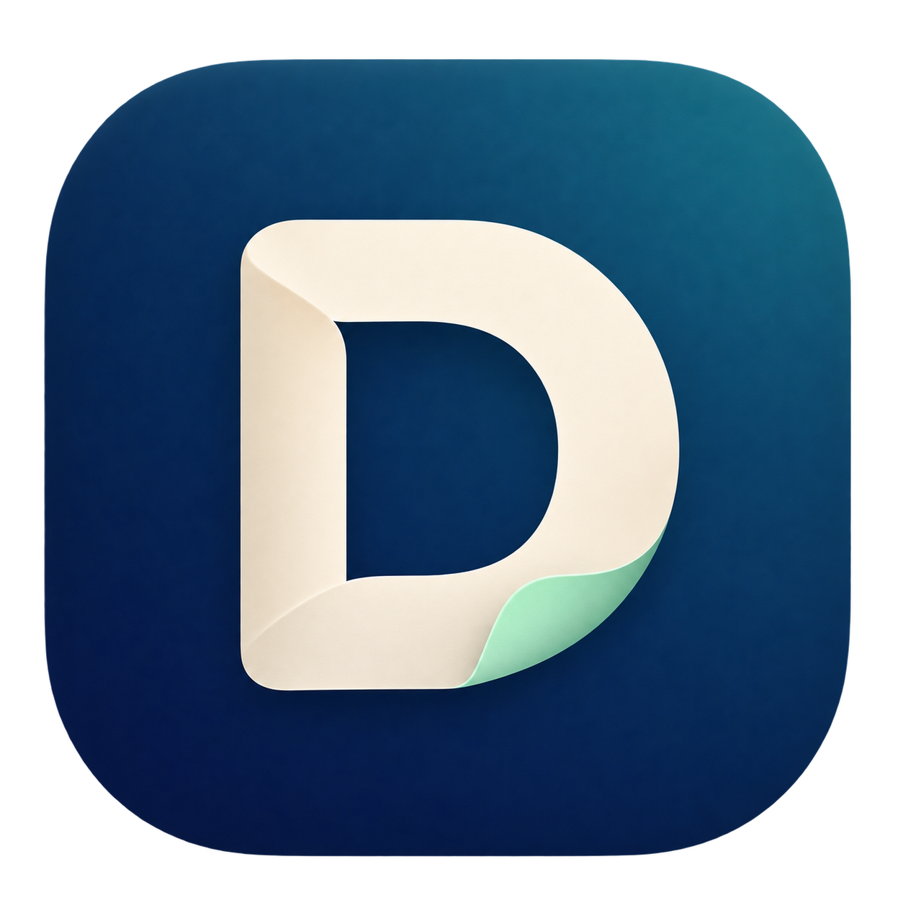
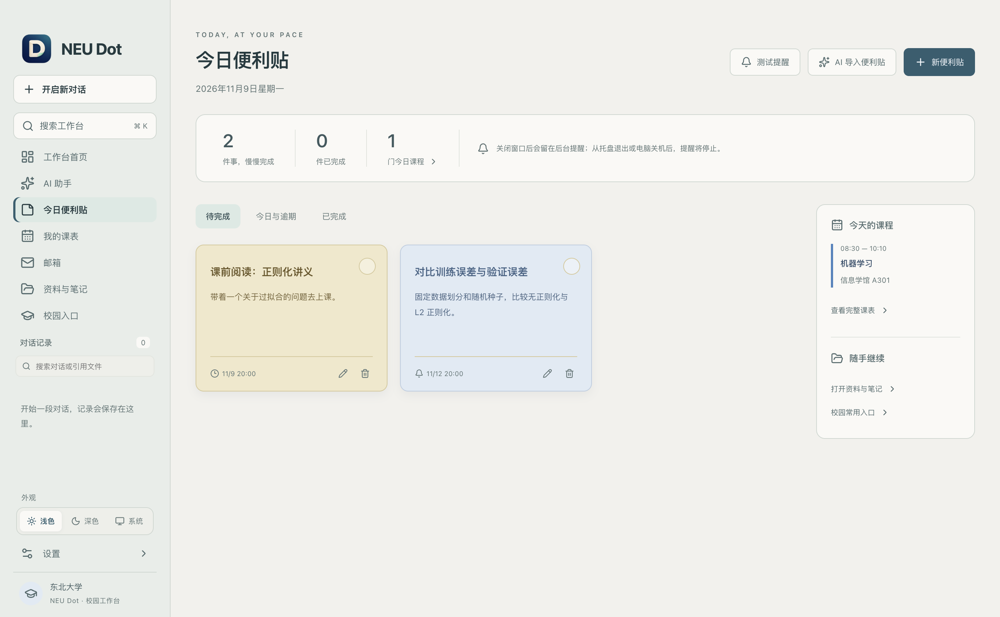
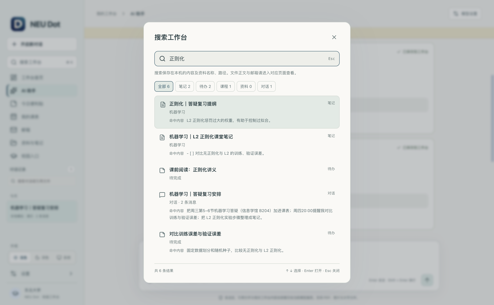
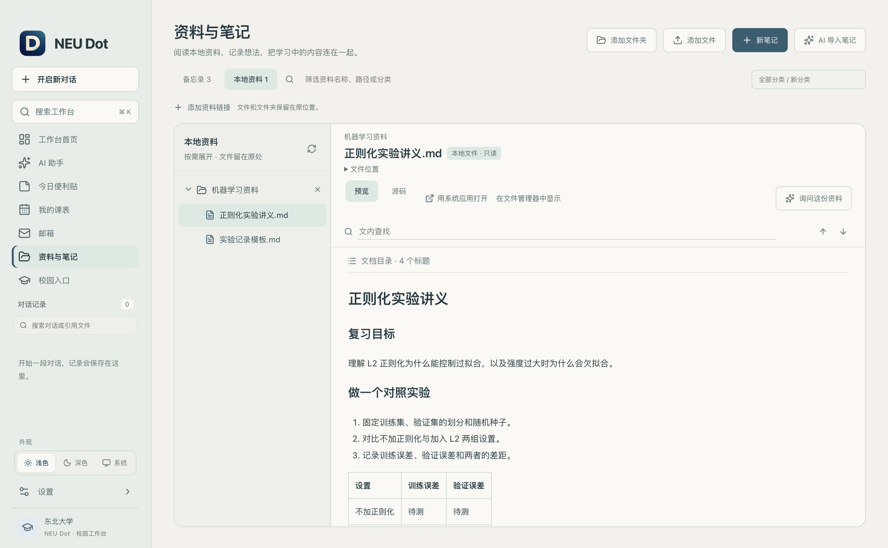
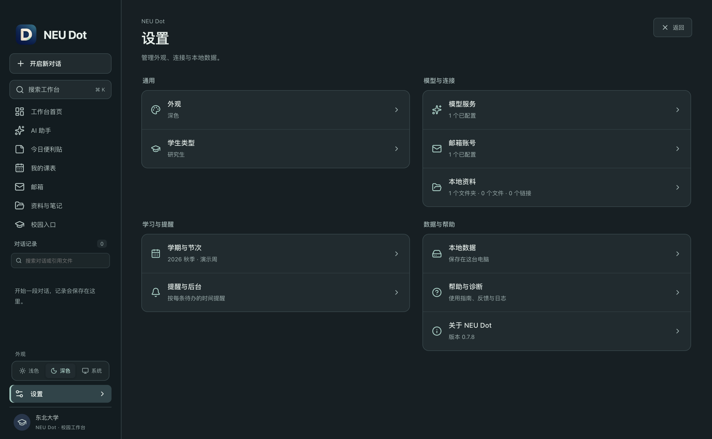
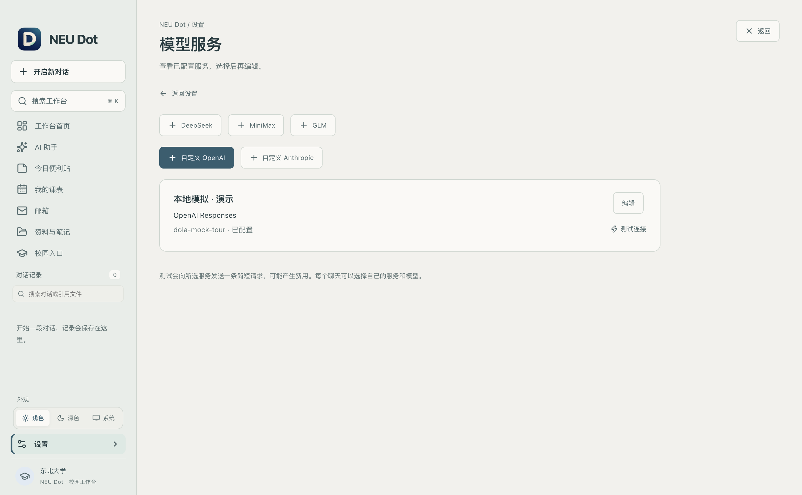

<p align="center">
  
</p>

<h1 align="center">NEU Dot</h1>

<p align="center">
  <strong>你的课表、待办、资料与 AI，一个工作台。</strong>
</p>

<p align="center">面向东北大学本科生与研究生 · 本地优先 · macOS / Windows</p>

<p align="center">
  <a href="https://github.com/yzbcs/NEU-Dot/releases/latest"></a>
  <a href="https://github.com/yzbcs/NEU-Dot/actions/workflows/ci.yml"></a>
  
</p>

<p align="center">
  <a href="https://github.com/yzbcs/NEU-Dot/releases/download/v0.7.8/NEU-Dot-0.7.8-mac-arm64.dmg"><strong>↓ 下载 macOS DMG</strong></a> ·
  <a href="https://github.com/yzbcs/NEU-Dot/releases/download/v0.7.8/NEU-Dot-0.7.8-win-x64.exe"><strong>↓ 下载 Windows 安装包</strong></a> ·
  <a href="https://github.com/yzbcs/NEU-Dot/releases/latest">全部下载</a> ·
  <a href="docs/usage.md">使用指南</a> ·
  <a href="https://github.com/yzbcs/NEU-Dot/issues">反馈</a>
</p>


> 面向东北大学学生的个人开发项目。提供 Apple Silicon Mac 与 Windows x64 安装包，当前版本为 **0.7.8**，安装包未签名。

应用已启用 **NEU Dot** 名称，并加入应用内更新提醒、下载进度与重启安装。0.7.6 及更早版本需要先手动安装一次 0.7.7，后续版本可通过应用内更新。

[功能演示](#功能演示) · [开始使用](#开始使用) · [本地开发](#本地开发) · [更新说明](docs/releases/v0.7.8.md)

## 下载

在 [最新版发布页](https://github.com/yzbcs/NEU-Dot/releases/latest) 的 Assets 中选择对应的安装包。

| 平台                  | 安装包 |
| --------------------- | ------ |
| macOS · Apple Silicon | `.dmg` |
| Windows · x64         | `.exe` |

安装包未签名，系统可能显示发布者提示。Windows 版本已打包，实机运行待验证。

## 功能演示

### 从接下来的一件事开始

首页显示当前课程或下一项定时安排，把**未来七天的课程与待办**放在同一条日程中。可以直接完成、恢复待办，打开最近笔记，或进入完整课表。


- **待办与提醒**：四色便利贴、定时与重复提醒、推迟提醒；点击通知定位到对应待办。
- **全局搜索**：按 `⌘/Ctrl + K` 查找笔记、待办、课程、本地资料和聊天，直接打开原记录。
- **外观与启动**：浅色、深色、跟随系统；启动显示加载状态，失败时提供原因与重试入口。

### 把待办变成一张张便利贴

按自己的习惯用颜色整理待办，设置截止时间、重复规则和提醒。完成后卡片原位保留，也可以恢复或主动收起。



### 随时找到工作台里的内容

按 `⌘/Ctrl + K` 搜索课程、待办、笔记、本地资料与聊天，点击结果回到对应记录。



### 把课表带进工作台

首次启动选择本科生或研究生，课表网页导入会打开对应学校系统，之后可在“设置 → 学生类型”统一修改。也支持 PDF 和教务系统导出的 Excel、Word 课表文件，以及手动录入。保存前预览并修正课程、周次与学期，支持单双周、自定义节次、课程配色、冲突提示和 ICS 导出。点击课程可以新建课堂笔记，或查看同名课程的笔记与资料。


网页导入需要自行登录学校系统并主动读取当前课表。本科网页及其 Excel、Word 导出文件已使用真实样例验证，三条路径均生成 40 条课程安排，包含实验课以及教师、地点随周次变化的安排。学校导出的合并单元格会丢失部分课程各自的结束节次，文件导入预览会列出需要核对的课程。研究生网页及 PDF 已有真实样例验证，扫描 PDF 可手动录入。

### 让笔记和资料留在手边

用笔记本整理课程、阅读记录和随手备忘。支持置顶、正文搜索、模板、自动保存、导出和可勾选清单，也可以添加本机文件、文件夹与网页链接。


在“本地资料”中添加课程或项目文件夹，按需展开目录，点击 Markdown 就能阅读正文、表格、代码块和本地图片。支持预览／源码切换、文内查找、相对文档链接和刷新，也能用系统应用打开文件。



文件保留在原目录，应用笔记保存在工作台中。点击“询问这份资料”会带着当前文件准备提问草稿，发送后 AI 才读取相关内容；新增的文件读取来源和本地文件搜索结果可直接回到对应文件。PDF 等格式可用系统应用查看。

邮箱支持学校云邮箱、QQ、163 和自定义 IMAP/SMTP，可管理多账号、阅读邮件、下载附件、回复和发信。校园入口跟随全局学生类型，展示对应的常用服务。

### 在设置中管理你的工作台

设置先显示外观、模型、邮箱、学期和本机数据的当前状态，按通用、模型与连接、学习与提醒、数据与帮助四组组织，共十个入口。进入模型或邮箱列表后再编辑，保存配置与测试连接分别操作。



0.7.2 提供 **DeepSeek、MiniMax、GLM** 快捷入口，自动填写服务地址、协议和默认模型。也可以使用自定义 OpenAI 或 Anthropic 兼容接口，按需编辑全部连接信息。



聊天中的“模型设置”定位当前对话使用的服务，返回后继续编辑原草稿。学期与节次可单独修改，保留已有课程和导入来源；邮箱设置管理账号，打开设置不会自动收信。

### AI 读懂工作台，也能按指令保存

连接支持工具调用的模型后，AI 可以查询课表、待办、笔记、已添加的本地资料和已配置邮箱，并附上可点击核对的来源。

输入框旁的“引用文件”可添加 PDF、图片和文字资料，供 AI 识别课表、提取待办或整理笔记。课表 PDF 导入识别失败时，也可点击“交给 AI 识别此 PDF”，将原文件带入聊天。整张课表会先生成草稿，预览核对后确认保存。图片与扫描 PDF 需要支持图片理解的模型，并在模型服务中开启对应选项。

明确要求保存时，可以让它**创建待办、追加课程或保存笔记**。完成的操作会留下真实记录的结果卡，支持查看、编辑与撤销。


例如：

- “结合明天的课表和未完成待办，帮我安排学习。”
- “帮我添加明天 20:00 的论文阅读提醒。”
- “把上面的内容保存成笔记。”

模型服务与 API Key 由使用者自行配置，支持 OpenAI Responses、Chat Completions 兼容接口和 Anthropic Messages。每个对话都可按问题使用工作台工具，引用文件与相关内容会发送给所选模型服务。文件可从聊天直接引用，也可在“本地资料”添加后读取。

<details>
<summary>查看启动界面</summary>


数据就绪后进入首页；加载失败时可查看原因并重试。

</details>

<details>
<summary>截图版本与演示数据</summary>

截图基于 NEU Dot 0.7.8 界面重新生成，全部使用人工演示数据。AI 操作结果由本地模拟服务展示。

</details>

## 开始使用

1. 安装并打开应用，选择本科生或研究生，再在“我的课表”导入或手动添加课程。
2. 在首页新建待办，在“资料与笔记”记录笔记、添加文件夹并阅读本地资料。
3. 按需在“设置 → 模型服务”连接模型，在“设置 → 邮箱账号”配置邮箱。

关闭窗口后应用可在托盘继续运行；**退出应用或电脑关机后，提醒不会运行**。AI 并非使用课表、待办和笔记的前提。详细步骤见[使用指南](docs/usage.md)。

## 本地开发

桌面端使用 Electron、React 和 TypeScript。AI 会话使用 Pi SDK 对接模型服务与工作台工具。

推荐 Node.js **24.22.1**，版本见 [.node-version](.node-version)。

```sh
npm ci
npm run dev
```

构建应用：

```sh
npm run build
```

GitHub Actions 在 Mac 和 Windows 上构建安装包。打包和发布步骤见[发布指南](docs/releasing.md)。

[更新记录](CHANGELOG.md) · [参与贡献](CONTRIBUTING.md)
