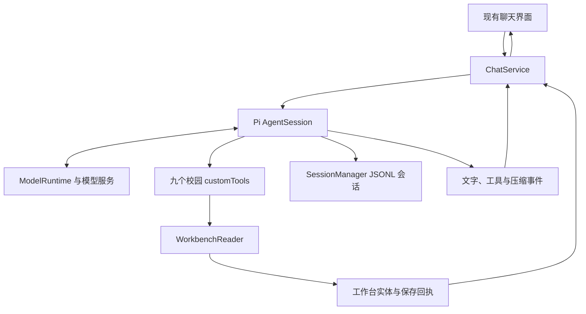

# Pi SDK 与校园工作台运行时

NEU-Dela **0.5.0** 接入 **Pi 1.5.0 原生 SDK**。Pi 负责模型与工具之间的执行循环、完整 JSONL 会话记录和自动上下文压缩；NEU-Dela 保留桌面界面、模型服务配置、校园工具、真实保存回执和撤销行为。

相关依赖为 `@earendil-works/pi-coding-agent`、`@earendil-works/pi-agent-core` 与 `@earendil-works/pi-ai`，均固定为 `1.5.0`。

Pi 负责会话执行与上下文管理；课程周次、学期设置、提醒时间、资料读取与实际保存由项目的工具和数据模型处理。

## 职责与调用路径

| 文件 | 职责 |
| --- | --- |
| [pi-session.ts](../src/main/pi-session.ts) | 创建或恢复 Pi 会话、首次导入旧聊天、配置资源加载与自动压缩 |
| [chat.ts](../src/main/chat.ts) | 将校园工具注册为 `customTools`，把 Pi 事件映射到现有 UI，处理保存回执、去重、停止、撤销和删除聊天 |
| [ai.ts](../src/main/ai.ts) | 注册模型服务与协议、提供系统提示词、查询模型列表与测试连接 |
| [workbench.ts](../src/main/workbench.ts) | 定义九个校园工具，复用 `WorkbenchReader` 执行查询、读取与创建 |
| [store.ts](../src/main/store.ts) | 保存工作台、界面聊天记录、服务设置与加密凭据 |



每次发送消息时，`ChatService` 打开或创建该聊天对应的 Pi 会话，订阅事件，再调用 `session.prompt()`。Pi 处理模型请求、工具结果与后续模型回复；这一轮结束后释放会话对象，下一轮从持久化会话恢复。

## 九个校园工具

工具定义来自现有 `workbenchTools`，通过 `customTools` 交给 Pi。参数校验和实际执行继续复用 `WorkbenchReader`，创建操作进入原有工作台保存逻辑。

| 工具 | 作用 |
| --- | --- |
| `query_workspace` | 查询课程、待办、笔记、关联资料、邮箱账号和校园入口 |
| `read_workspace_item` | 读取指定笔记或待办正文 |
| `list_files` | 分页列出已关联文件夹的一级目录 |
| `read_file` | 分段读取已关联文本文件，或按页读取 PDF |
| `list_mail` | 分页读取已配置邮箱的邮件目录 |
| `read_mail` | 读取指定邮件的纯文本正文与附件名称 |
| `create_todo` | 按明确请求创建待办或提醒 |
| `add_courses` | 向当前课表追加课程，保留已有课程与学期设置 |
| `create_note` | 按明确请求创建笔记 |

开启工作台访问时注册上述工具；关闭时不提供工作台工具。工具按顺序执行，单次用户请求保留最多 6 轮工具调用、12 次工具执行的应用限制。达到上限后移除可用工具，让模型基于已有结果回答。

Pi 默认终端与文件操作工具未启用。资源加载器关闭外部 extensions、skills、提示词模板、主题与上下文文件加载，使用项目自己的系统提示词。内置 `before_agent_start` hook 将提示词中的默认 cwd 标识替换为“校园工作台”，避免发送真实应用数据目录；实际会话存储路径保持不变。文件访问仍从用户已关联的资料进入；邮箱工具只读，不发送邮件。

## 现有界面与真实操作回执

`ChatService` 将 Pi 的文字增量、工具开始与结束、上下文压缩事件转换为现有聊天状态。界面继续显示流式文字、读取过程、来源引用和创建结果卡；压缩时显示“整理对话上下文”。

创建成功后，工具返回实际保存的实体。`ChatService` 立即把回执写入界面聊天记录，再让 Pi 请求模型续接。因此，停止生成或后续模型请求失败时，已经保存的记录与回执仍然保留，保存成功不依赖模型最后是否说出“已添加”。

同一条回复内，创建参数先经过规范化，再与本轮成功结果直接比较。等价请求返回已有实体和回执，避免重复创建；下一条用户消息使用新的本轮记录。

结果卡继续支持查看、编辑和撤销。撤销复用 `WorkbenchReader.undoCreation()`：已被用户修改的记录会保留并提示手动处理。成功撤销后，聊天回执更新为已撤销，并向 Pi 会话追加一条工作台变更记录，提示后续回答重新查询当前状态。

## 两类聊天记录与旧会话导入

应用保留两类用途不同的本机记录：

| 记录 | 内容与用途 |
| --- | --- |
| `chats.json` | 现有界面使用的消息文字、来源、操作回执、状态和模型选择 |
| `pi-sessions` 下的 JSONL | Pi 保存的新消息、工具调用与结果、压缩记录，用于恢复模型上下文 |

Pi 会话使用聊天 ID 关联，存放在应用数据目录下的 `pi-sessions`。新回合由 Pi 保存完整的协议历史，而界面继续读取原有聊天数据结构。

旧聊天首次进入 Pi 时，若没有对应会话文件，会导入已有用户与助手文字，并把创建回执附为“工作台实际操作记录”。旧聊天原本没有保存完整工具往返内容，因此导入保留现有信息，不重建不存在的历史。已有 Pi 会话时直接打开，避免每轮重复导入。

删除聊天时，同时删除对应 Pi 会话文件和界面聊天记录；删除聊天不会撤销其中已经创建的工作台实体。生成期间需先停止，再删除聊天。

## 模型协议与凭据

现有服务配置继续使用三种协议，由 `createPiRuntime()` 映射到 Pi：

| NEU-Dela 协议 | Pi API |
| --- | --- |
| `openai-responses` | `openai-responses` |
| `openai-chat` | `openai-completions` |
| `anthropic` | `anthropic-messages` |

每个连接使用自己的 `ModelRuntime`，按用户配置注册服务地址、模型 ID 和 API Key。查询模型列表仍使用现有 OpenAI/Anthropic SDK；聊天续接由 Pi `AgentSession` 执行，连接测试使用 Pi 的单次流式请求。

凭据仍由应用的 `Store` 配合系统加密保存。Pi 使用 `InMemoryCredentialStore`，从当前连接获得密钥，不额外保存 Pi auth 文件。模型运行时不读取独立模型配置文件，也不在创建时自动联网刷新模型目录。

当前会话配置关闭自动重试、缓存预热和 Pi 遥测。OpenAI 兼容聊天请求沿用服务端默认输出限制，不主动附加 `max_tokens`、`max_completion_tokens` 或 `max_output_tokens`；Anthropic Messages 保留 SDK 所需的输出上限参数。

## 上下文预算与自动压缩

模型 ID 与协议在 Pi catalog 中匹配时，使用目录中的 `contextWindow` 和 `maxTokens`。未知模型使用以下本地预算估计：

| 参数 | 未知模型的估计值 |
| --- | --- |
| `contextWindow` | 32,768 tokens |
| `maxTokens` | 4,096 tokens |

这些值用于本地预算，不代表自定义服务实际公布或支持的容量。

自动压缩启用，预留空间与近期内容预算使用同一个值：

```ts
const contextReserve = Math.min(8192, Math.floor(model.contextWindow / 4));

compaction: {
  enabled: true,
  reserveTokens: contextReserve,
  keepRecentTokens: contextReserve,
}
```

因此，采用 32,768-token 估计窗口的模型，两项预算均为 8,192 tokens。压缩由 Pi 根据当前上下文与模型预算管理，保留近期内容并整理较早对话；压缩记录进入同一份 JSONL 会话。UI 订阅压缩开始和结束事件，显示进行中、完成、中止或失败状态。自动压缩会额外调用当前模型生成摘要，并消耗相应服务额度。

## 验证状态

152 项单元与本机 HTTP/邮件测试通过，生产构建通过；Mac 完整桌面流程 72 项检查与动作流程 11 项检查通过，均包含重启恢复。Windows 安装包与 10 项包内资源检查通过，尚未实机运行。协议验证使用人工数据与本机模拟服务，真实模型质量尚未评估。
